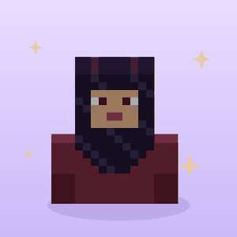
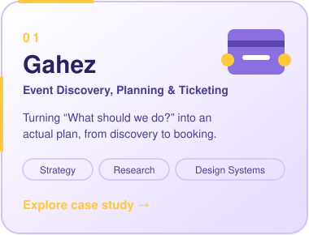
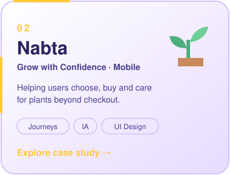
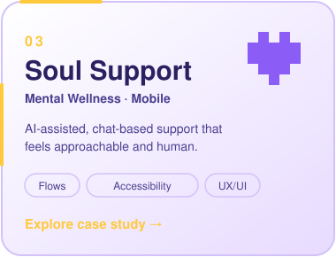

<picture><source media="(prefers-color-scheme: dark)" srcset="assets/hero-dark.svg"></picture>

 

*Designing intuitive digital experiences through user research, product thinking, and thoughtful interaction design.*

## ✨ About Me

<table>
<tr>
<td width="320" align="center"> Hi, I'm Abrar 👋</td>
<td>

I'm a Product Designer with a background in Computer Science & Software Engineering, interested in turning complex problems into intuitive, meaningful digital experiences.

My approach combines user-centered design, research-driven decisions, interaction design, and technical understanding. I focus on understanding people, identifying opportunities, and translating insights into thoughtful product experiences.

With experience in programming and mobile development, I bring a design-to-development perspective to my work, helping bridge the gap between user needs and technical feasibility.

**Areas of focus:** Product Design · UX Research · Interaction Design · Information Architecture · UI Design · Prototyping · Design Systems

</td>
</tr>
</table>

## 🎨 Selected Work

<table>
<tr>
<td><a href="YOUR_GAHEZ_CASE_STUDY_URL"><picture><source media="(prefers-color-scheme: dark)" srcset="assets/card-1-dark.svg"></picture></a></td>
<td><a href="https://abrarayman27.github.io/Nabta/"><picture><source media="(prefers-color-scheme: dark)" srcset="assets/card-2-dark.svg"></picture></a></td>
<td><a href="https://abrarayman27.github.io/soulsupport-ux-case-study/"><picture><source media="(prefers-color-scheme: dark)" srcset="assets/card-3-dark.svg"></picture></a></td>
</tr>
</table>

<b>01 — Gahez</b> · Event Discovery, Planning & Ticketing | End-to-End Product Design

 

An event discovery and planning experience designed to turn *"What should we do?"* into an actual plan. Gahez helps users discover experiences, compare options, coordinate with friends, and book events with greater confidence.

The product explores the complete event journey, from personalized discovery and collaborative planning to ticket booking and event preparation, across mobile and web experiences.

**Focus areas:** Product Strategy · UX Research · User Journeys · Information Architecture · Interaction Design · Design Systems · UI Design

[Explore the Gahez Case Study →](YOUR_GAHEZ_CASE_STUDY_URL)

<b>02 — Nabta</b> · Grow with Confidence | End-to-End Mobile Product Design

 

An end-to-end plant ownership experience designed to help users discover suitable plants, make confident purchasing decisions, and care for their plants beyond checkout.

The project explores the complete ownership journey, translating user needs and research insights into product opportunities, user flows, interface design, and a cohesive visual system.

**Focus areas:** UX Research · Journey Mapping · Information Architecture · UI Design · Interaction Design

[Explore the Nabta Case Study →](https://abrarayman27.github.io/Nabta/)

<b>03 — Soul Support</b> · Mental Wellness | Mobile Product Design

 

A digital mental wellness product concept exploring how thoughtful digital experiences can make support more approachable through AI-assisted features and chat-based interactions.

The project focuses on shaping a user-centered experience around accessibility, meaningful interactions, and the needs of people seeking support.

**Focus areas:** Product Thinking · UX/UI Design · User Flows · Mobile Experience Design

[Explore the Soul Support Case Study →](https://abrarayman27.github.io/soulsupport-ux-case-study/)

## 🧭 Design Approach

I approach product design as a problem-solving process, not simply an exercise in creating interfaces.

<picture><source media="(prefers-color-scheme: dark)" srcset="assets/process-dark.svg"></picture>

My process focuses on:

- 🔍 Understanding user needs, behaviors, and pain points.
- 🎯 Identifying opportunities and defining the right problems.
- 🗺️ Structuring clear and intuitive user journeys.
- ✏️ Translating insights into purposeful interfaces and interactions.
- 🧪 Testing assumptions and refining solutions.
- ♿ Considering accessibility, business goals, and technical feasibility.

## 🛠️ Skills & Tools

<picture><source media="(prefers-color-scheme: dark)" srcset="assets/skills-dark.svg"></picture>

| Product & UX | UI & Interaction Design | Development |
| --- | --- | --- |
| UX Research | Figma | Flutter |
| User Journeys | FigJam | Dart |
| Information Architecture | Wireframing | Firebase |
| User Flows | Prototyping | HTML & CSS |
| Usability Testing | Design Systems | JavaScript |
| Product Thinking | Interaction Design | Python |

## 🎓 Background & Recognition

- **B.Sc. in Computer Science & Software Engineering**, Alexandria University, 2025.
- **Best Capstone Project recognition**, Software & Information Systems.
- **UX and UI Design training**, including the Nielsen Norman Group UX curriculum and Route IT UI/UX Diploma.

## 🌱 Beyond Design

My technical background and experience in programming education have strengthened my ability to explain complex concepts, approach problems logically, and communicate ideas clearly.

I value continuous learning, thoughtful collaboration, and the opportunity to create digital products that make everyday experiences better.

## 💌 Let's Connect

I'm interested in opportunities to contribute to meaningful digital products, collaborate with multidisciplinary teams, and continue growing as a Product Designer.

- **LinkedIn:** [Connect with me](https://linkedin.com/in/abrar-ayman-9ba724222)
- **Behance:** [Explore my design work](https://www.behance.net/abrarayman2)
- **Portfolio:** [View my case studies](https://abrarayman27.github.io/abrar-ayman-portfolio/)
- **GitHub:** [Explore my repositories](https://github.com/abrarayman27)
- **Email:** [abrarayman81@gmail.com](mailto:abrarayman81@gmail.com)

*Design with empathy. Think in systems. Build with purpose.*

